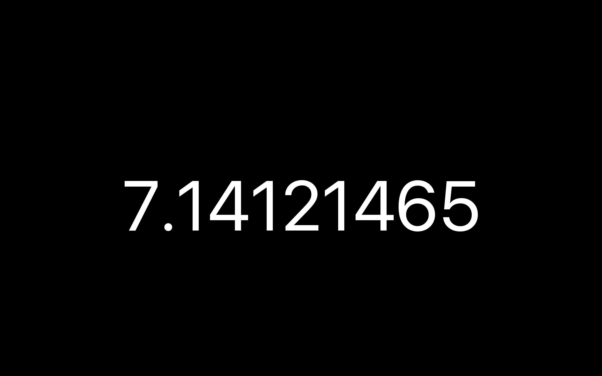

# Year Percentage Wallpaper



A macOS wallpaper generator that displays the percentage of the year that has elapsed. The wallpaper updates automatically to show your year progress in real-time.

## Features

- 🎨 **Dynamic Year Progress**: Displays the exact percentage of the year completed (with 8 decimal precision)
- 🔄 **Auto-Update**: Can be configured to update automatically every minute via launchd
- 🖥️ **Multi-Display**: Auto-detects every connected display and generates a wallpaper at each display's native resolution
- 🖼️ **Customizable**: Adjustable colors, precision, and update interval
- 🚀 **Easy to Use**: Double-click script or run from terminal
- 🧹 **Self-Cleaning**: Only the most recent wallpapers are kept on disk (default: 5)

## Requirements

- macOS (uses AppleScript for wallpaper setting)
- Python 3.x
- Pillow (PIL) library

## Setup

Follow these steps to set up the project:

### Step 1: Clone or Download the Repository

```bash
git clone <repository-url>
cd wallpaper
```

Or download and extract the project to your desired location.

### Step 2: Set Up Virtual Environment

1. Create a virtual environment in the project directory:
   ```bash
   python3 -m venv venv
   ```

2. Activate the virtual environment:
   ```bash
   source venv/bin/activate
   ```
   
   You should see `(venv)` in your terminal prompt, indicating the virtual environment is active.

3. **Note**: Remember to activate the virtual environment each time you work with this project:
   ```bash
   source venv/bin/activate
   ```

### Step 3: Install Requirements

Install the required Python packages:

```bash
pip install -r requirements.txt
```

Or install manually:
```bash
pip install Pillow
```

To verify the installation:
```bash
python3 -c "from PIL import Image; print('Pillow installed successfully')"
```

### Step 4: Set Up Launchd Script (Automatic Updates)

To enable automatic wallpaper updates every 60 seconds:

1. **Copy the launchd plist file**:
   ```bash
   cp launchd.plist ~/Library/LaunchAgents/com.user.dynamicwallpaper.plist
   ```

2. **Update the paths in the plist file** to match your system:
   
   Open the plist file in a text editor:
   ```bash
   open ~/Library/LaunchAgents/com.user.dynamicwallpaper.plist
   ```
   
   Or edit with nano:
   ```bash
   nano ~/Library/LaunchAgents/com.user.dynamicwallpaper.plist
   ```
   
   Update these two paths in the `ProgramArguments` array:
   - **Python path**: Replace `/Users/YOUR_USERNAME/Path/to/wallpaper/venv/bin/python3` with your actual path
     - To find your Python path: `which python3` (while venv is activated)
   - **Script path**: Replace `/Users/YOUR_USERNAME/Path/to/wallpaper/generate_and_set_wallpaper.py` with your actual project path
     - Use the full absolute path to `generate_and_set_wallpaper.py`

   Example (if your project is in `/Users/yourname/projects/wallpaper`):
   ```xml
   <key>ProgramArguments</key>
   <array>
     <string>/Users/yourname/projects/wallpaper/venv/bin/python3</string>
     <string>/Users/yourname/projects/wallpaper/generate_and_set_wallpaper.py</string>
   </array>
   ```

3. **Load the launchd service**:
   ```bash
   launchctl load ~/Library/LaunchAgents/com.user.dynamicwallpaper.plist
   ```

4. **Verify it's running**:
   ```bash
   launchctl list | grep dynamicwallpaper
   ```

5. **Check the logs** (if needed):
   ```bash
   tail -f /tmp/dynamicwallpaper.out
   tail -f /tmp/dynamicwallpaper.err
   ```

6. **To stop automatic updates** (unload the service):
   ```bash
   launchctl unload ~/Library/LaunchAgents/com.user.dynamicwallpaper.plist
   ```

7. **To remove the service completely**:
   ```bash
   launchctl unload ~/Library/LaunchAgents/com.user.dynamicwallpaper.plist
   rm ~/Library/LaunchAgents/com.user.dynamicwallpaper.plist
   ```

**Note**: The launchd service will:
- Run the wallpaper update script every 60 seconds
- Run once immediately when loaded
- Continue running even after you log out and log back in
- Log output to `/tmp/dynamicwallpaper.out` and errors to `/tmp/dynamicwallpaper.err`

## Usage

### Manual Update

**Option 1: Double-click script**
- Double-click `Update Wallpaper.command` to generate and set a new wallpaper

**Option 2: Command line**
```bash
python3 generate_and_set_wallpaper.py
```

### Automatic Updates (launchd)

If you've set up the launchd service (see **Step 4** in the Setup section above), the wallpaper will automatically update every 60 seconds.

**Quick commands:**
- Check if service is running: `launchctl list | grep dynamicwallpaper`
- View logs: `tail -f /tmp/dynamicwallpaper.out`
- Stop service: `launchctl unload ~/Library/LaunchAgents/com.user.dynamicwallpaper.plist`
- Start service: `launchctl load ~/Library/LaunchAgents/com.user.dynamicwallpaper.plist`

## Configuration

### Command-line options

```bash
python3 generate_and_set_wallpaper.py --decimals 8 --keep 5
```

- `--decimals N`: decimal places shown (default `8`)
- `--keep N`: number of generated wallpaper files to keep (default `5`)

### Update interval

The update interval is controlled by `StartInterval` (in seconds) in the launchd plist. You don't need 8 decimals at slower intervals, so pair them:

| Interval | `StartInterval` | Suggested `--decimals` |
|---|---|---|
| Every minute (default) | `60` | `8` |
| Hourly | `3600` | `4` |
| Daily | `86400` | `2` |

To pass options under launchd, add them as extra `<string>` entries after the script path in `ProgramArguments`, e.g. `<string>--decimals</string><string>4</string>`.

### Script settings

Edit the configuration section at the top of `generate_and_set_wallpaper.py`:

```python
BACKGROUND_COLOR = "black"   # Background color
TEXT_COLOR = "white"         # Text color
FONT_SIZE_RATIO = 0.1875     # Font size as a fraction of display height
OUTPUT_DIR = os.path.expanduser("~/wallpapers")  # Output directory
FONT_PATH = "/System/Library/Fonts/SFNS.ttf"     # System font path
```

Resolution is detected automatically; `DEFAULT_SIZE` is only a fallback.

## File Structure

```
wallpaper/
├── README.md                      # This file
├── requirements.txt               # Python dependencies
├── generate_and_set_wallpaper.py  # Main script: generates and sets wallpaper
├── Update Wallpaper.command      # Double-clickable script for easy updates
├── launchd.plist                 # launchd plist template for automation
└── venv/                         # Virtual environment (create with python3 -m venv venv)
```

## Output

Generated wallpapers are saved to `~/wallpapers/` with filenames like:
- `dynamic_wallpaper_20250127_143022_2560x1600.png`

Older generated files are deleted automatically (see `--keep`). Only files matching `dynamic_wallpaper_*.png` are touched.

## Notes

- The wallpaper displays the percentage with 8 decimal places for precision
- The script uses AppleScript to set the wallpaper, which requires macOS
- With multiple displays, it assumes System Events lists desktops in the same order as the displays; if wallpapers land on the wrong screen, please open an issue
- Logs for the launchd service are written to `/tmp/dynamicwallpaper.out` and `/tmp/dynamicwallpaper.err`
- Make sure to grant necessary permissions if macOS prompts for accessibility access

## License

This project is open source and available for personal use.
